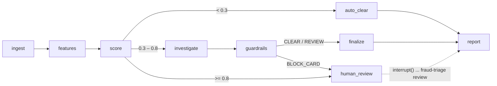

# fraud-triage-agent

[](https://github.com/HelenArams/fraud-triage-agent/actions/workflows/ci.yml)
[](LICENSE)

Rules engines catch the obvious stuff; the grey zone ends up in an analyst queue,
and most of an analyst's first five minutes on a case is the same routine: pull the
card's history, look at the merchant, remember whether we've seen this pattern
before, write two lines of rationale. I wanted to see how much of that routine an
agent can do *before* a human opens the case, without ever being the one that
actually blocks a card.

This is a small LangGraph agent that triages suspicious card transactions. Plain
Python features and a rule score decide where a transaction goes. Claude (via the
Anthropic API or Amazon Bedrock) investigates the middle band with a few read-only
tools and writes a short, evidence-referenced rationale. Anything that would block a
card stops at a human, and the graph waits for them with LangGraph's `interrupt()`
and a SQLite checkpointer.

## How it flows



- **ingest**: validates the row, masks anything that looks like a full PAN (Luhn
  check over 13–19 digit runs), drops history from other cards and from the future.
- **features**: velocity over 1h/24h, amount z-score against the card's history,
  card/merchant/IP country mismatch, new device, risky MCC (gambling, crypto/quasi-cash,
  money transfer), ecom without 3DS, and a card-testing pattern (lots of tiny auths
  across different merchants inside an hour).
- **score**: combines the signals noisy-OR style (`1 - Π(1 - wᵢ)`) into a 0–1 score
  with human-readable reasons. Thresholds live in settings.
- **investigate**: Claude with tool use: `feature_breakdown`, `card_history`,
  `merchant_profile`, `similar_cases` (a tiny local case library), and
  `submit_decision`, which takes a pydantic `TriageDecision`
  (`CLEAR | REVIEW | BLOCK_CARD`, confidence, rationale, evidence refs).
- **guardrails**: see below.
- **human_review**: `interrupt()` parks the thread in SQLite. The CLI resumes it
  later, from a different process, with the analyst's call.
- **report**: Markdown + JSON per transaction.

Above 0.8 I don't ask the model at all. The rules are loud enough, and the human
gets a rules-only proposal instead of paying for tokens to restate the obvious.

## Quick start

Python 3.12. No keys needed for the demo: the default provider is `offline`, a
rule-based stand-in for the model that speaks the same tool protocol, so the whole
graph (tools, guardrails, interrupt/resume) runs locally.

```bash
make venv install
.venv/bin/fraud-triage run samples/transactions.csv --out out/
```

`samples/transactions.csv` has 36 transactions across six cards: a traveller, an
account takeover, a card-testing burst, a casino deposit, a merchant descriptor with
a prompt injection in it, and someone buying groceries. One row came out of the
"export" with a full PAN in it on purpose, to show the loader masking it.

Some of the output:

```
┃ txn    ┃ score ┃ band ┃ path                                    ┃ verdict         ┃
│ t_0023 │ 0.05  │ low  │ auto_clear                              │ CLEAR           │
│ t_0024 │ 0.54  │ mid  │ investigate > guardrails > human_review │ awaiting review │
│ t_0025 │ 0.42  │ mid  │ investigate > guardrails > finalize     │ REVIEW          │
│ t_0028 │ 0.79  │ mid  │ investigate > guardrails > human_review │ awaiting review │
│ t_0029 │ 0.82  │ high │ human_review                            │ awaiting review │
│ t_0033 │ 0.39  │ mid  │ investigate > guardrails > finalize     │ REVIEW          │
│ t_0034 │ 0.43  │ mid  │ investigate > guardrails > finalize     │ REVIEW          │
provider: offline, 36 transactions, 4 waiting for review
  fraud-triage review t_0024 --approve|--reject --note '...' --out out
```

Then play analyst:

```bash
.venv/bin/fraud-triage review t_0024 --approve --note "cardholder confirmed, card reissued" --out out/
.venv/bin/fraud-triage review t_0029 --approve --note "BIN attack, matches scheme alert" --out out/
.venv/bin/fraud-triage explain t_0024     # feature + score breakdown for one txn
```

`--approve` keeps the proposed verdict, `--reject` clears it, `--verdict REVIEW`
overrides either way. `out/t_0024.md` ends up like this:

```markdown
# t_0024: BLOCK_CARD

- card: `535522******0914`
- amount: 899.00 GBP at `m_curry_online` (GB, mcc 5732, ecom)
- rule score: **0.54** (mid)
- path: ingest > features > score > investigate > guardrails > human_review

## Signals

- `amount_spike` (0.25): amount z-score 72.2
- `ip_country_mismatch` (0.15): IP country differs from card country
- `new_device` (0.15): device not seen on this card before
- `three_ds_missing` (0.15): ecom without 3DS authentication

## Decision

**BLOCK_CARD**, confidence 0.77

Rule score 0.54; driven by amount_spike, ip_country_mismatch, new_device, three_ds_missing; closest past case C-103 was fraud.

Evidence: `rule_score`, `feature:amount_spike`, `feature:ip_country_mismatch`, `feature:new_device`, `feature:three_ds_missing`, `case:C-103`, `case:C-104`, `case:C-109`

## Human review

- analyst: approved
- note: cardholder confirmed, card reissued
```

(That rationale is from the offline analyst, so it reads like a template. With Claude
it's an actual sentence or three.)

### Using Claude

Settings come from env vars (or a `.env` file):

```bash
# Anthropic API
export FRAUD_PROVIDER=anthropic
export ANTHROPIC_API_KEY=...
export FRAUD_MODEL=claude-sonnet-4-5        # default

# Amazon Bedrock (uses your normal AWS credential chain)
export FRAUD_PROVIDER=bedrock
export FRAUD_AWS_REGION=eu-central-1        # or AWS_REGION
export FRAUD_BEDROCK_MODEL=eu.anthropic.claude-sonnet-4-5-20250929-v1:0
```

The Bedrock default is the `us.` cross-region inference profile for Sonnet 4.5;
change the prefix to match your region. Both clients go through the same
`messages.create` path in the `anthropic` SDK (`Anthropic` vs `AnthropicBedrock`),
and both put a cache breakpoint on the system prompt. Tools render before the system
prompt, so that one breakpoint covers the tool definitions too. Check
`cache_read_input_tokens` in the debug log; if the prefix is under the model's
minimum cacheable size it silently won't cache.

Other knobs: `FRAUD_LOW_THRESHOLD` (0.30), `FRAUD_HIGH_THRESHOLD` (0.80),
`FRAUD_CLEAR_CEILING` (0.50), `FRAUD_MAX_TOOL_TURNS` (6).

## Guardrails

The model never acts on anything directly. Its decision passes through a guardrails
node first, and routing is decided by code:

- **No auto-clear above the ceiling.** If the model says CLEAR but the rule score is
  ≥ 0.5, it becomes REVIEW (and confidence is capped). Rules can be overruled upward
  by the model, never downward past that point.
- **Evidence or it didn't happen.** Every evidence ref has to exist: a feature that
  was computed, a case in the library, a transaction in this card's history, the
  merchant, or the rule score. Made-up refs are dropped. If nothing is left, the
  verdict becomes REVIEW.
- **PAN scrubbing on the way out.** Model output gets the same Luhn-based masking as
  the input. PANs are masked on load anyway, but I don't want to depend on that.
- **Merchant text is data.** Descriptors come from the acquirer feed, which means
  anyone with a merchant account can write into the prompt. They only reach the model
  inside `<untrusted_merchant_text>` (with angle brackets neutralised so they can't
  close the tag), tools never return them, and a regex tripwire flags
  instruction-looking descriptors and refuses to auto-clear them. The test suite has a
  model that *does* obey the injection and checks that the routing doesn't change.
- **Tools are read-only and scoped.** `card_history` only returns the card under
  review. There is no tool that can change anything.
- **Model outages degrade to REVIEW** instead of failing the run.

## Evals

`evals/cases.yaml` has six labelled scenarios: card testing, account takeover,
legit traveller, high-risk MCC, injection in the merchant name, and a clean one.

```bash
make eval        # offline analyst, runs in CI
make eval-live   # whatever FRAUD_PROVIDER points at
```

Offline, this mostly checks the plumbing: features, bands, routes, guardrails. Live,
it tells you whether the model's verdicts line up with the labels. Six cases is a
smoke test, not a benchmark.

## Development

```bash
make lint   # ruff check, ruff format --check, mypy --strict on src
make test   # pytest, fully offline: fakes for the SDK, no network
```

The `FakeClient` in `fraud_triage/llm/fake.py` replays scripted tool calls, which is
how the tests cover tool errors, invalid decisions, runaway loops and the injection
case without an API key.

## Honest limits

- This is a triage helper, not a fraud model. Scores come from a handful of simple
  features with weights I picked by hand; the LLM explains and routes, it doesn't
  learn anything.
- History is whatever is in the input file. A real setup would query a feature
  store, and velocity would be computed on the authorization stream, not in batch.
- The case library is ten hand-written cases and "similarity" is Jaccard over fired
  signals. Good enough to give the model something to cite, nothing more.
- The injection tripwire is a regex. The real protection is structural (routing
  doesn't read descriptors, the ceiling, the human gate). The regex just makes
  attempts visible.
- One thread per transaction id, one SQLite file per output dir. Fine on a laptop,
  not what you'd run against a live queue.

## Roadmap

- [ ] pull history from a real store instead of the input file
- [ ] embed the case library and do proper retrieval for `similar_cases`
- [ ] a tiny web view for the review queue instead of the CLI

## License

MIT
